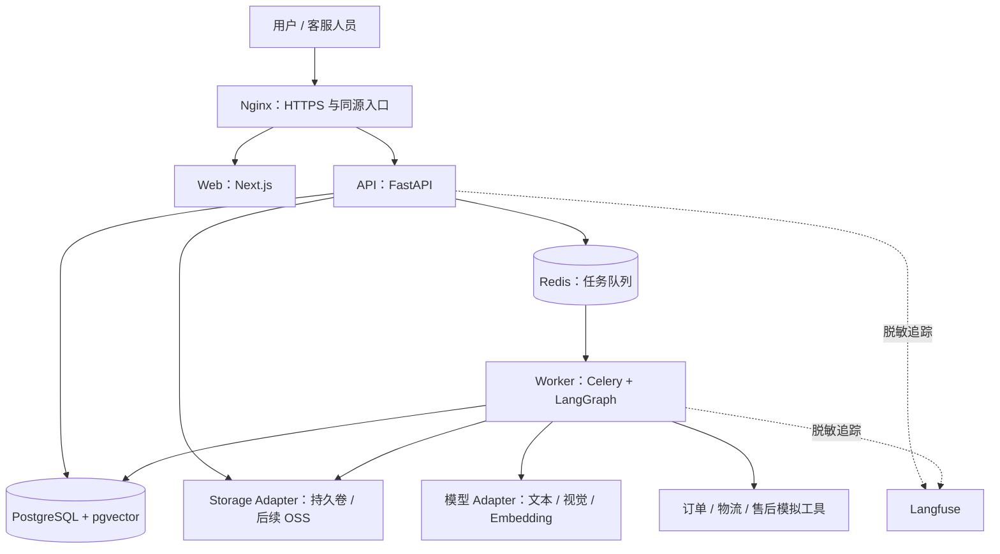

# 电商售后多模态多 Agent 客服工单系统：整体结构规划

日期：2026-11-14

更新：2026-11-17，补充公开仓库、私密配置隔离与下载复现要求。

状态：设计已认可；2026-11-17 开始实施 P0，实际进展见执行计划与验证记录。

项目根目录：下载或克隆后的仓库目录，不依赖个人机器路径。
建议仓库名：`ecommerce-support-agent`（由实施者采用的建议名称，未创建 GitHub 仓库）。

## 1. 项目目标与当前状态

面向电商售后，接受文字与商品照片/物流截图，识别问题、查询订单、检索售后政策、形成处置建议并创建/更新工单；需要人工确认的操作暂停，确认后恢复执行。首期为单商家作品集项目，使用合成订单与模拟交易接口。

优先实现：退款申请、退货申请、物流异常、商品破损四类场景。目标是展示可执行、可追踪、可恢复的业务流程，以及可以从本地迁移到阿里云 ECS 的工程能力。

用户已确定：电商售后定位；先做好环境基础；后续推送 GitHub；Docker 容器运行于 ECS；ACR 存储和分发镜像。

交付约束：最终 GitHub 仓库公开；私密配置和真实业务数据不得进入仓库或发布镜像；其他用户通过 clone 或下载 ZIP 获得代码后，应能按 README 在自己的环境运行演示。

本次只读检查结果：

- 项目目录起初为空，没有 Git 仓库，也没有发现根目录或父目录 AGENTS.md。
- 可找到 Git、Python、Node.js、uv、Docker CLI 和 Compose。
- 本机默认 Python 为 3.13.9，Node.js 为 24.18.0。
- Docker CLI 为 29.9.3，Compose 为 5.7.0；Docker API 管道连接失败，当前没有验证引擎可运行。
- 读取 Docker 用户配置同时出现 Access is denied；实施时分别核查引擎状态与配置访问权限，不据此断言 Docker 未安装。

首期不接入真实支付，不自动向真实客户发送消息，不搭建多商家平台，不做本地 GPU 推理。后续可以替换外部接口适配器；模拟操作在页面、日志和演示中明确标识。

## 2. 架构选择与取舍

| 方案 | 收益 | 代价 | 结论 |
| --- | --- | --- | --- |
| 一个同步接口完成全部流程 | 最快跑通 | 难覆盖后台任务、人工等待和失败恢复 | 用作评测基线，不作为最终架构 |
| 单仓库 + 模块化后端 + 独立任务进程 | 部署边界清晰、共享业务代码、可逐步扩展 | 需要定义任务和状态的一致性 | 推荐方案 |
| 每个 Agent 一个微服务 + Kubernetes | 可以独立扩缩容 | 开发部署负担大，业务收益暂不充分 | 随业务规模增长再评估 |

采用第二种方案。Agent 是 LangGraph 工作流里的职责节点或子图，不与 Docker 容器一一对应。首期只维护前端和后端两种业务镜像，API 与 Worker 复用同一个后端镜像，以不同命令启动。

## 3. 系统拓扑



建议基础技术选型（除已核实版本外，均为设计建议，安装时以兼容性解析结果锁定）：

| 层次 | 建议 | 原因 |
| --- | --- | --- |
| 前端 | Next.js + React + TypeScript，Node.js 24 | 用户提交与客服工作台共用一个应用 |
| 后端 | Python 3.12 + FastAPI + Pydantic | 使用项目专属运行时；API 与业务模块分离 |
| 依赖 | uv + uv.lock；pnpm + pnpm-lock.yaml | CI、镜像与本地复现同一组依赖 |
| 编排 | LangGraph + PostgreSQL checkpointer | 支持工作流状态持久化与人工恢复 |
| 数据 | PostgreSQL 17 + pgvector；SQLAlchemy + Alembic | 工单、审计、知识检索共用一套数据库实例，逻辑分区 |
| 后台任务 | Celery + Redis 7.4 | 执行较慢的图片处理、检索和工作流任务 |
| 模型 | 可配置的文本、视觉与 Embedding Adapter | 接入百炼/Qwen 等提供方；模型 ID 由配置给出 |
| 观测 | Langfuse Python SDK，确切版本待接入时核查并锁定 | 查询官方 SDK 文档与发布信息，再验证与 LangGraph 的兼容性 |
| 交付 | Docker + Compose + GitHub Actions + ACR + ECS | 同一套镜像从构建流转到部署 |

Python 3.12 是保守兼容基线，并非要求覆盖本机 Anaconda；通过 uv 管理项目运行时。数据库与 Redis 镜像的具体补丁版本、digest，以及框架版本，在环境实施时校验后记录到依赖基线，不能直接依赖漂移的 latest。

Langfuse 首期采用外部服务，可关闭；未配置时项目仍能运行并输出本地结构化日志。其是否能够从目标 ECS 访问需在部署前验证。暂不把整套 Langfuse 自托管组件加入小型 ECS。

## 4. 仓库结构

以下为规划目录，并非已经创建的代码脚手架。空模块随实际业务开发建立。

```text
ecommerce-support-agent/
├── README.md                      # 启动、架构、演示和部署入口
├── LICENSE                        # 发布前确定授权方式
├── .gitignore                     # 凭据、运行数据、缓存、构建产物
├── .gitattributes                 # shell 脚本等统一换行符
├── .dockerignore                  # 控制根上下文，屏蔽密钥与数据
├── .env.example                   # 只含示例值
├── .python-version
├── compose.yaml                   # 公共服务与网络，不含开发专属挂载
├── compose.dev.yaml               # 开发构建、热更新、仅回环地址调试端口
├── compose.prod.yaml              # ACR 镜像、重启策略、资源限制
├── apps/
│   ├── backend/
│   │   ├── pyproject.toml
│   │   ├── uv.lock
│   │   ├── Dockerfile             # dev / production 构建目标
│   │   ├── .dockerignore
│   │   ├── alembic.ini
│   │   ├── migrations/            # 业务表迁移
│   │   ├── src/support_agent/
│   │   │   ├── main.py            # API 进程入口
│   │   │   ├── worker.py          # Worker 进程入口
│   │   │   ├── api/               # 路由、请求响应 Schema、鉴权依赖
│   │   │   ├── core/              # 配置、日志、错误、权限基础
│   │   │   ├── domain/            # 工单、订单、审批、金额、状态与规则
│   │   │   ├── services/          # 创建工单、审批、查询、附件等用例
│   │   │   ├── agents/            # 图、状态、节点、恢复入口
│   │   │   ├── tools/             # Agent 可用的受限业务工具
│   │   │   ├── integrations/      # 模型、物流、存储、交易、Langfuse 适配器
│   │   │   ├── repositories/      # 数据持久化实现
│   │   │   ├── tasks/             # Celery 任务、分发、重试、补偿
│   │   │   └── knowledge/         # 文档摄入、切分、检索、引用
│   │   └── tests/
│   │       ├── unit/
│   │       ├── integration/
│   │       └── contract/
│   └── web/
│       ├── package.json
│       ├── pnpm-lock.yaml
│       ├── Dockerfile
│       ├── .dockerignore
│       └── src/
│           ├── app/               # 用户售后入口、客服工作台
│           ├── components/
│           ├── lib/               # 同源 API 客户端、认证、展示工具
│           └── types/generated/   # 从 OpenAPI 生成，避免手抄接口
├── configs/
│   └── policies/                  # 商家售后政策、阈值、SLA，含版本号
├── prompts/                       # 分类、视觉理解、回复模板及版本
├── data/
│   ├── samples/                   # 可公开的少量合成样例
│   └── knowledge/                 # 可公开的演示售后政策
├── evals/
│   ├── datasets/                  # 冻结测试集，与训练/调参样例分离
│   ├── graders/
│   └── reports/                   # 小型汇总；原始大结果不入 Git
├── tests/e2e/                     # 提交、查询、审批、恢复演示路径
├── infra/
│   ├── nginx/                     # 路由、上传限制、HTTPS 配置模板
│   └── ecs/                       # 服务目录、环境文件、发布清单模板
├── scripts/
│   ├── setup.ps1 / setup.sh       # 幂等创建本地配置、生成本机演示凭据
│   ├── dev.ps1 / dev.sh
│   ├── check.ps1 / check.sh
│   ├── seed.py                    # 可重复初始化的合成订单与知识数据
│   ├── deploy.sh
│   └── rollback.sh
├── docs/
│   ├── superpowers/specs/         # 设计与约束
│   ├── runbooks/                  # 本地配置、ECS、ACR、备份恢复
│   ├── adr/                       # 关键架构取舍
│   └── dependency-baseline.md     # 锁定版本、镜像 digest、模型版本
└── .github/workflows/
    ├── ci.yml                     # 检查、测试、构建验证
    ├── publish-images.yml         # 可信发布事件 → ACR
    └── deploy.yml                 # 首期手动触发 → ECS
```

边界约定：API 不直接调用模型；通过 services 进入业务用例。Agent 不直接执行任意 SQL、网络请求或退款，只通过受限 tools。工具调用 services 校验权限和业务规则，integrations 负责对外适配。API 与 Worker 共享 domain/services，防止规则出现两套。

## 5. 工作流与业务数据

建议初版工作流：

```text
提交文字/图片 → 保存工单与附件 → 创建异步任务
→ 图片理解（仅有图片时）→ 意图与实体提取
→ 缺字段则等待用户补充
→ 按已登录用户权限查订单/物流 + 检索有效售后政策
→ 确定性规则校验 → 生成回复或售后申请建议
→ 需要审批则持久化暂停 → 人工批准/驳回 → 恢复任务
→ 模拟执行售后操作 → 保存结果与引用 → 客户确认/客服关闭
```

首期保留分类、视觉理解、知识检索、处置建议、回复和升级等职责节点；确定性订单查询、金额计算、阈值检查使用普通函数，不强制每个节点都调用 LLM。

核心实体：users、orders、order_items、shipments、tickets、ticket_messages、attachments、agent_runs、approval_requests、action_executions、audit_events、knowledge_documents、knowledge_chunks、outbox_events。

领域工单状态与执行任务状态分离：

- 工单：open、waiting_customer、processing、waiting_approval、resolved、closed。
- 执行：queued、running、interrupted、succeeded、failed。
- 使用 ticket_id 关联会话，run_id 关联一次执行，thread_id 关联图检查点；不能混用这些标识。
- PostgreSQL 业务表是工单、审批、执行结果的事实来源；checkpointer 负责图状态；Redis 负责队列，不作为唯一工单存储。
- 重启后可从 PostgreSQL 恢复待审批任务；同一工作流恢复使用原 thread_id，并校验 graph_version 与 state_schema_version。
- API 保存任务及 outbox 事件于同一事务，任务分发器发送到队列；定期对账未发送/超时任务，避免“已建单但未入队”。
- Worker 按至少一次执行设计。同一 run 防并发执行；写操作携带稳定的 action_id 幂等键。重试时查询 action_executions，不能重复创建退款申请。
- 审批记录绑定具体动作、金额、订单、政策版本与输入摘要；内容变化即重新审批。恢复入口做权限、版本和状态检查。
- 图片仅作为辅助证据；其识别结果不能单独决定赔付。订单号即使来自图片也必须校验归属。

金额以最小货币单位整数存储，明确币种。售后资格、可退金额、商家阈值和政策有效期由确定性规则验证。

## 6. 接口与前端规划

API 前缀统一 `/api/v1`，建议接口契约：

- `POST /tickets`：提交问题，返回 ticket_id 与 run_id。
- `POST /tickets/{id}/messages`：补充材料或继续对话。
- `POST /attachments`：上传受限类型附件，返回 attachment_id。
- `GET /tickets/{id}`、`GET /tickets/{id}/messages`：读取工单与会话。
- `GET /runs/{id}`：轮询异步执行状态，首期不要求 WebSocket。
- `POST /approvals/{id}/decisions`：客服审批，独立权限检查。
- `POST /tickets/{id}/close`：关闭工单并记录原因。
- `GET /health/live`：进程存活；`GET /health/ready`：数据库与队列就绪。

前端分成用户售后入口与客服工作台。展示上传、补充信息、处理进度、依据来源、建议动作、审批和历史；内部追踪仅向有权限的客服显示。自动回复生成后不直接将工单标为 closed。

开发和 ECS 均优先使用 Nginx 同源 `/api` 路由，浏览器不接触内部容器地址，避免把 ECS IP 编译进前端。服务端 API 地址通过运行配置提供。

登录采用可替换的认证模块；首期演示用户角色为 customer、agent、admin。公开部署前必须实现登录、对象级访问权限与模拟动作标识。无鉴权模式仅用于本机绑定回环地址的开发。

## 7. 本地开发与容器基础

主路径：Docker Desktop Linux containers → Compose 运行 web、api、worker、postgres、redis、nginx；开发环境挂载源码、开启热更新。Python 和 Node 项目环境用于 IDE、静态检查及必要的本地调试。

本地命令入口由脚本统一封装，内部统一使用 `docker compose -f compose.yaml -f compose.dev.yaml ...`；ECS 使用 `compose.prod.yaml` 覆盖。

环境基础阶段必须交付：

1. Git 初始化、忽略规则、换行规范与根 README。
2. Python 项目与前端最小启动入口、依赖锁文件及专属运行时说明。
3. 按 dev / production 分层构建的 Dockerfile，api 与 worker 复用镜像。
4. Compose 公共配置及开发/生产覆盖，健康检查、数据卷与内部网络。
5. 配置加载、`.env.example`、错误格式、结构化日志、请求 ID、存活/就绪端点。
6. Alembic 迁移机制、初始演示数据入口与独立的 checkpointer 初始化步骤。
7. 一个不依赖真实模型密钥的 smoke 路径：提交任务、队列消费、持久化状态、读取结果。
8. CI 基础检查与镜像构建验证；ACR 发布和 ECS 部署先预留清晰的配置契约。

Compose 用健康条件等待数据库就绪；迁移由一次性任务执行，成功后启动 API/Worker，不让多个副本同时竞争迁移。LangGraph 检查点表初始化单独纳入一次性初始化流程。

Mock 模型模式必须显式标识，仅用于环境验证；真实模型验收单独报告。环境阶段不以“模型能答一句话”代替数据库、队列和重启恢复验证。

## 8. GitHub → ACR → ECS 发布链路

```text
开发分支 → Pull Request → CI
→ 合并 main / 版本标签 → 构建 linux/amd64 镜像
→ 推送 ACR 的 backend 与 web 仓库
→ 生成包含两个镜像 digest 的 release manifest
→ 手动触发部署 → ECS 拉取同一批镜像
→ 备份/检查迁移兼容性 → 单次迁移 → 启动 → 就绪与业务 smoke 验证
```

ACR 用于镜像存储与分发；ECS 用于运行容器，二者职责分开。首期 ECS 建议选 Linux x86_64；若后续选择 ARM，则构建目标对应调整或发布多架构镜像。

发布设计：

- ACR registry、namespace、backend 仓库、web 仓库、实例地域均为参数，不硬编码某个个人版/企业版域名。
- GitHub 构建执行器使用可访问的 registry 端点，ECS 使用获准访问的端点；地域与网络访问策略在云资源确定时核对。
- 标签包含 `sha-<commit>` 与可选 `vX.Y.Z`；部署清单固定 digest，两个业务镜像出自同一提交。
- `latest` 可以作为辅助标签，但不作为部署或回滚依据。
- API 与 Worker 拉取相同 backend digest，避免代码和状态定义不一致。
- 发布工作流仅对可信分支/标签开放，PR 尤其外部 PR 不获得云凭据。
- ACR 推送凭据放 GitHub Secrets；ECS 使用最小范围拉取权限。运行密钥保存在服务器受限环境文件，不能写入镜像或 Git。
- 基础镜像与三方服务版本纳入 release manifest；CI 记录源码提交和依赖锁文件。
- 首次云部署为手动触发，待 smoke 与回滚流程稳定后再决定是否自动部署。
- 每次发布保存上一份 manifest；支持恢复上一组镜像。数据库迁移采取向后兼容的扩展/收缩方式，镜像回滚不等于数据库回滚。
- 单 ECS Compose 首期接受短暂部署中断；不宣称零停机或高可用。

## 9. 数据持久化、配置与运维

建议配置分组：APP_ENV、DATABASE_URL、REDIS_URL、MODEL_PROVIDER、TEXT_MODEL、VISION_MODEL、EMBEDDING_MODEL、模型密钥、STORAGE_BACKEND、上传限制、LANGFUSE 配置、ACR_REGISTRY、ACR_NAMESPACE、镜像 digest。具体变量名在实施时形成唯一配置契约。

- PostgreSQL 和 Redis 不向公网发布端口；ECS 公开应用入口为 80/443，SSH 访问按来源限制。
- 上传文件开发时用持久卷；预留 OSS Adapter。数据库保存对象 key、类型、大小与归属，不保存宿主机绝对路径。为跨 API/Worker 共享，二者挂载相同上传卷。
- 附件通过已授权的下载接口或短期签名 URL 访问；不能把用户提交的任意 URL 直接作为服务端下载目标。
- 支持的文件类型、实际内容、大小、图片像素及数量均有限制；附件原文与用户输入作为不可信内容。
- 数据库备份和文件备份保存在主机之外；定期做恢复演练。迁移或删除卷前先核查备份。
- 真实订单、聊天、上传文件、密钥、数据库导出与完整追踪数据不进 GitHub；样例和评测数据需可公开且注明来源。
- 日志输出 stdout，字段包含 request_id、ticket_id、run_id、trace_id；过滤令牌、手机号、地址和完整图片。
- Langfuse 不可用时降级为本地日志，追踪故障不应阻断工单；记录丢失情况并在进程退出时按 SDK 文档 flush。
- 监控 API 可用性、Worker 心跳、队列积压、任务超时、数据库磁盘和模型调用失败；仅 API 健康不足以证明系统可用。

## 10. 验证与评测

环境验收：

- 一份示例配置可启动全部基础服务，密钥为空时可跑明确标记的 Mock smoke。
- ready/live 语义正确；数据库未就绪时 API 不被判为就绪。
- 提交任务 → Worker 消费 → 数据库存储 → API 查询结果完整通过。
- 容器重启保留工单、附件与待审批状态；重复投递不重复执行业务动作。
- 数据库可由空库迁移初始化；迁移失败阻止新服务上线。
- 能构建两种 Linux 业务镜像，并使用生产覆盖配置验证无源码挂载运行。
- CI 不需要云账号和真实模型密钥，也能完成基础检查。
- 从干净源码副本（包括 ZIP 解压、无 .git 目录）按 README 初始化，使用 Mock 模式与合成数据完成启动和任务链路；不依赖开发者机器路径、私有 ACR 或未提供的本地文件。
- 发布前检查暂存内容、已跟踪文件与历史中的敏感信息，并验证镜像构建上下文与产物不包含私密配置。

业务验收：

- 四类场景的意图 Macro-F1、实体抽取准确率与多模态证据提取准确率。
- 政策引用正确率、无依据回答率、售后规则决策准确率。
- 应升级工单召回率、误升级率、审批绕过次数、重复动作次数。
- 端到端成功率（符合期望工单状态且业务动作正确），以及不转人工的自动解决率，分别报告。
- p50/p95 延迟、每工单 Token 与成本、并发错误率。
- 冻结测试集与调参集分开，对比“规则 + 检索 / 单 Agent / 多 Agent”，仅在收益覆盖成本时增加 Agent。
- 阈值在基线实验后确定，不能预先把目标数字写成已实现结果。CI 使用小型确定性回归；付费模型评测手动或按预算触发。

## 11. 递进实施顺序

| 阶段 | 主要交付 | 退出条件 |
| --- | --- | --- |
| P0 环境与工程底座 | Git、锁文件、容器、配置、数据库、队列、健康检查、CI、Mock smoke | 在本地通过环境验收；尚不需要云账号 |
| P1 单场景闭环 | 物流异常：模拟订单/物流查询、工单、简单检索与回复 | 一条可复现端到端链路与基线评测 |
| P2 四场景与多 Agent | 退款/退货/破损、多模态、工具权限、政策规则、人工暂停恢复 | 覆盖异常、重试、审批与重复执行测试 |
| P3 客服工作台与评测 | 用户/客服权限、审批界面、追踪、数据集、对比报告 | 完整演示和业务指标报告 |
| P4 云交付 | GitHub、ACR、ECS、HTTPS、备份恢复、版本发布回滚 | 从 ACR 拉取运行、smoke 与恢复演练通过 |

P0 即为当前优先任务。未来 P1-P4 在现有边界内补业务，无须重写部署结构；云账号信息到 P4 前提供即可，不能阻塞本地基础工作。

## 12. 实施前待确认与实施者可自行决定的部分

需要确认的是本设计整体方向。下列细节使用建议默认值即可，不逐项阻塞：单商家、合成订单、模拟售后操作、Linux amd64、单 ECS Compose、两种业务镜像、外部可关闭的 Langfuse。

ECS 实例、操作系统细版、ACR 实例类型/地址/地域、域名、证书与真实模型凭据尚未知。到云部署阶段核对；现在不创建云资源、不产生采购操作。国内公网域名的接入要求在目标地域与域名确定后查官方文档。

设计认可后，另写可执行的 P0 环境配置计划，再开始项目脚手架与依赖安装。此文档不代表环境已经配置完成。

## 13. 公开仓库与下载复现要求

### 13.1 配置与数据隔离

- 公开内容：源码、锁文件、Compose 模板、脱敏配置示例、可分发的合成数据、架构与运行文档。
- 私密内容：真实 `.env`、云与模型凭据、数据库密码、会话签名密钥、SSH 私钥、TLS 私钥、Docker 登录配置、生产部署参数、真实订单/客户/附件、运行日志及备份。
- `.env.example` 只列配置名称、用途和安全占位值；接入模型和云服务所需密钥由使用者本地填写，不能复制开发者配置作为模板。
- `.gitignore` 覆盖根目录与子目录中的环境文件、私钥、运行数据、上传和备份；仅按明确路径允许提交公开示例配置。各 Docker 构建上下文分别使用匹配的 `.dockerignore`。
- 模型、ACR 和 SSH 等密钥不写入 Dockerfile、构建参数、前端公开变量、截图、示例命令或日志。构建中确需访问私有资源时，实施前核对并采用临时构建 secret 机制。
- 私密部署环境文件保留在 ECS 受限目录；公开仓库中的 ECS 文件仅为通用模板。GitHub 云凭据通过 Secrets 注入。
- 当前设计中的本机用户名和绝对路径属于本地协作信息。公开版本文档改用仓库相对路径；发布前检查内部工作记录，避免附带个人路径和账号信息。
- 发布检查覆盖 Git 历史与已跟踪文件，不能只检查当前工作树和忽略规则。若凭据曾进入提交或公开产物，先吊销/轮换，再清理相关历史与产物，不能仅删除当前文件。

### 13.2 面向下载者的启动流程

README 的首个运行路径使用本地构建与 Mock 模型：下载代码 → 检查 Docker/Compose → 初始化本地配置 → 启动服务 → 访问页面 → 提交合成工单 → 查看结果。命令需在项目实现后实际验证，不把规划命令表述为已经可运行。

- Windows 提供 PowerShell 操作步骤；Linux/macOS 提供 shell 步骤，明确支持范围与最低工具版本。
- 初始化脚本只创建缺失配置，保留已有配置；为本机演示生成独立随机凭据，避免公开固定管理员密码。
- 默认不要求阿里云账号、付费模型密钥、Langfuse 账号或私有镜像拉取权限；演示界面明确说明 Mock 不代表真实模型效果。
- 用户需要验证真实模型时，再按独立章节配置自己的模型密钥；云部署使用独立章节及生产必填项校验。生产配置不允许回退到演示凭据或无鉴权模式。
- 从源码构建作为公开仓库的必备路径；开发者的 ACR 可以保持私有。若提供公共预构建镜像，单独说明地址、架构、版本和许可，不让它成为源码启动的唯一依赖。
- 下载 ZIP 的路径不能依赖 git 命令、Git submodule 或只有开发者本机才有的文件；必要资源随仓库提供，或通过明确可访问的来源获取。
- 说明首次下载依赖/镜像需要的网络条件、启动完成判断、端口、停止与再次启动方法、日志查看及常见问题。删除数据操作独立标明影响，不放入日常启动流程。

### 13.3 公开发布验收

- 选择并附带项目 LICENSE；确认示例图片、数据、文档及第三方资源的再分发权限，保留来源与许可说明。
- 外部贡献和 fork 可在没有私密变量的情况下运行基础 CI；镜像发布和 ECS 部署按可信事件独立执行。
- 配置初始化可重复执行且不覆盖使用者密钥；缺少真实运行必填项时给出不包含配置值的明确错误。
- 发布前从干净目录分别检查 clone 和 ZIP 运行路径；以合成数据完成一条端到端工单，核对没有开发机绝对路径或私有资源依赖。
- 推送前完成敏感信息检查，确认真实环境文件未跟踪；构建产物与镜像同样检查。自动扫描与人工核对配合执行，不能据一次扫描宣称绝无泄漏。

上述项目纳入 P0 的配置和启动脚本设计，并在 P4 公开发布前完成实际验收。

## 14. 实施时需核查的官方资料

本轮网络检索未返回可读资料，因此没有核实上述组件的最新发行版本与云产品细节。以下列出实施前应核查的官方资料；文中架构为本项目建议，不能视为已经完成官方兼容性验证：

- Docker Compose startup order：健康条件与一次性任务完成条件。
- Docker multi-platform builds：构建平台与宿主平台匹配。
- LangGraph Persistence：checkpointer、thread_id、持久化恢复与内存存储限制。
- Langfuse Observability、官方 llms.txt 与 PyPI 包发布信息：当前 SDK、追踪与评测能力。
- GitHub Actions Publishing Docker images：镜像构建、第三方 registry 与凭据配置。
- 阿里云 ACR 产品文档：镜像托管、分发、访问配置与推送拉取入口。具体实例使用步骤留到实例类型确定后核对。
